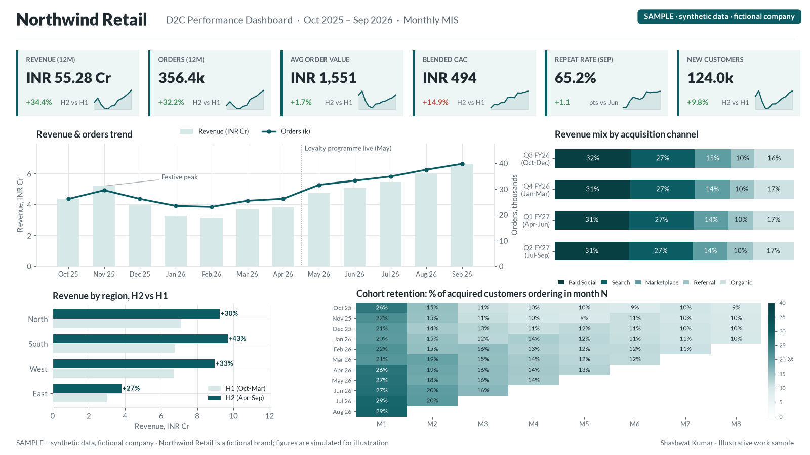

# kpi-dashboard-mis

**One set of numbers, defined once.** A reproducible KPI dashboard and monthly MIS pack, generated end to end from code.

> ⚠️ **Synthetic data, fictional company.** "Northwind Retail" does not exist. Every customer, order and rupee here is generated by a seeded simulator in this repo. Nothing comes from any real business or employer.



## The idea

Most dashboard arguments are really definition arguments. This repo starts from a metric dictionary (revenue, orders, average order value, acquisition cost, retention cohorts, marketing return) and builds every chart from the same computed table, so the PNG dashboard and the PDF MIS report can never disagree.

## What's inside

| Path | What it is |
|---|---|
| `dashboard/build_kpi_dashboard.py` | Simulates customers, orders and spend; computes KPIs; renders the dashboard and a 4-page MIS PDF |
| `dashboard/SYNTHETIC_*.csv(.gz)` | The generated datasets (monthly KPIs, cohort retention, marketing spend, orders) |
| `dashboard/northwind_kpi_mis_report.pdf` | The MIS pack the script produces |
| `common/style.py` | Shared chart styling |

## Run it

```bash
python -m venv .venv && source .venv/bin/activate
pip install -r requirements.txt
python dashboard/build_kpi_dashboard.py
```

The random seed is fixed, so outputs are reproducible.

## Related writing

- [Models are only as good as their inputs](https://readsigil.com/essays/data-quality.html)
- [When the score becomes the goal](https://readsigil.com/essays/goodhart.html)

MIT licensed.
